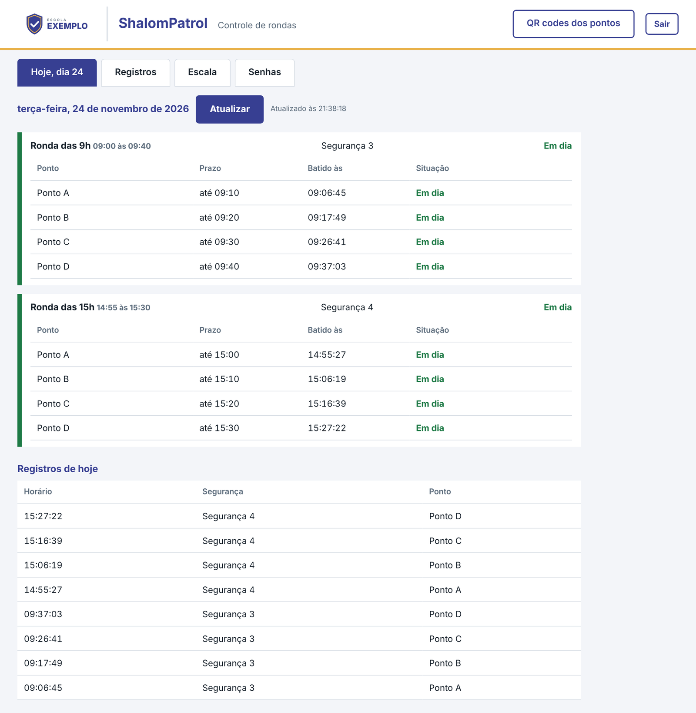
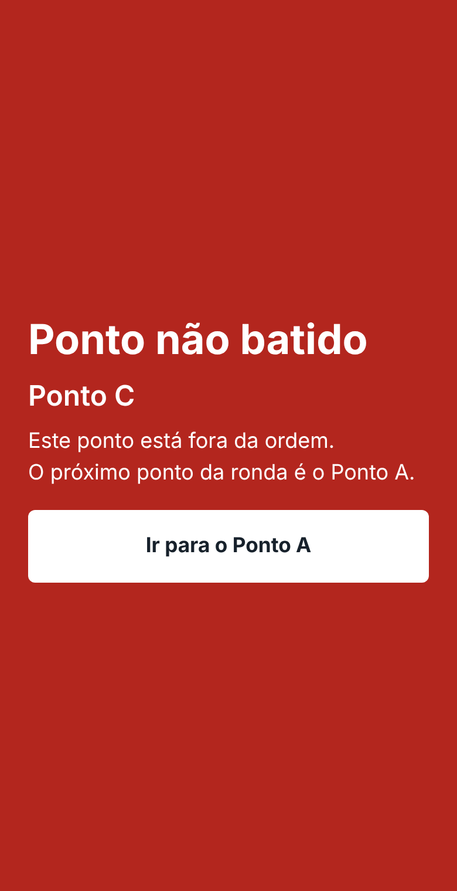
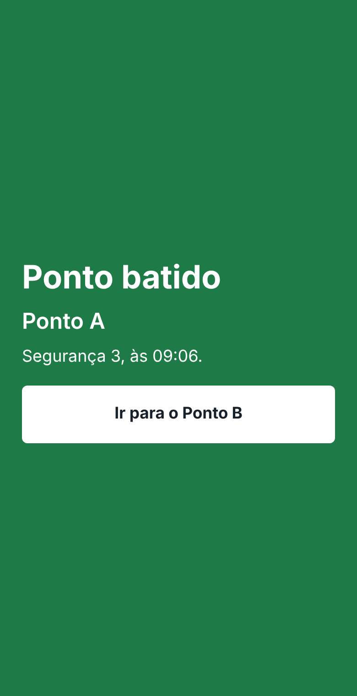
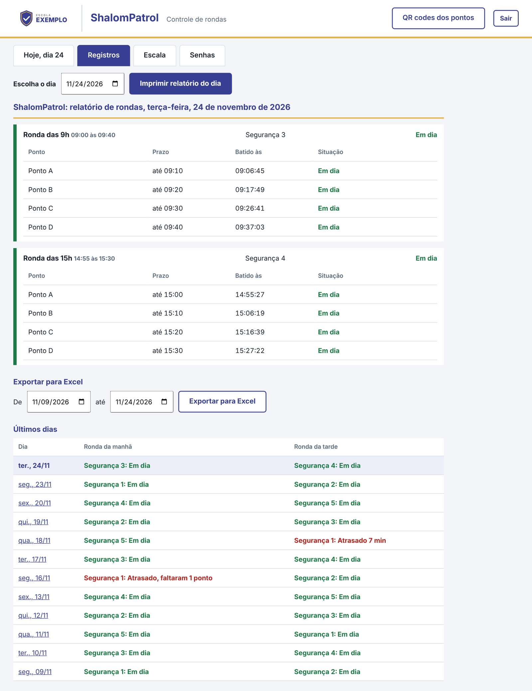
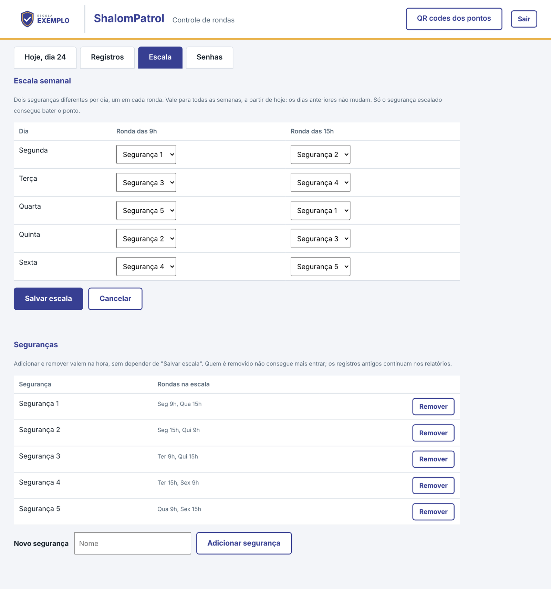
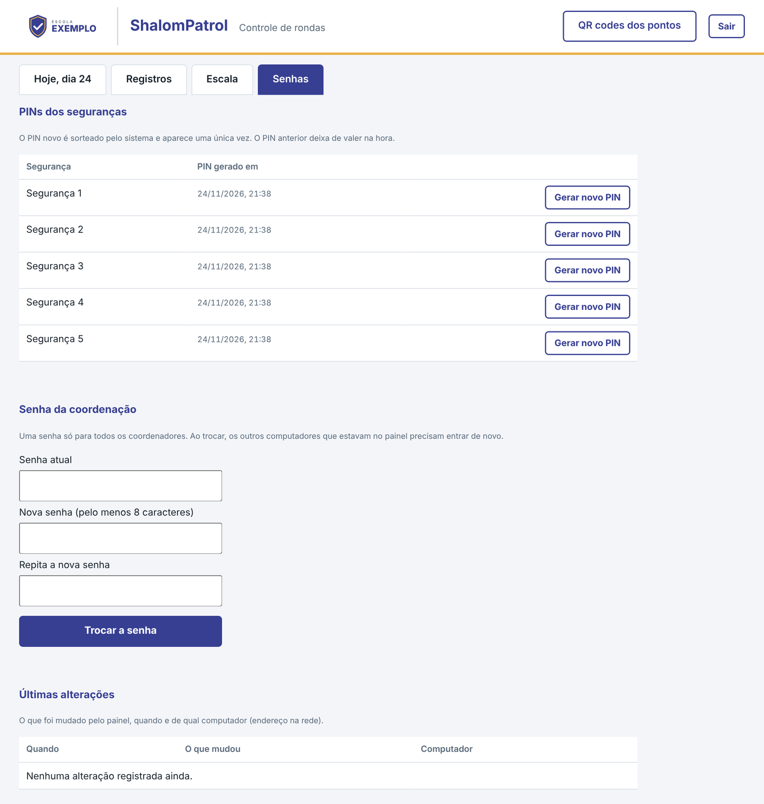
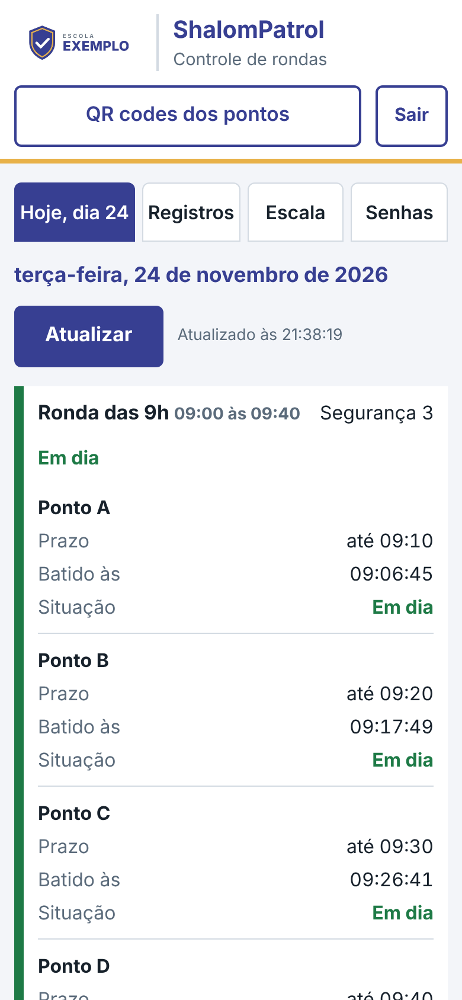

# ShalomPatrol

Sistema web para controlar as rondas de uma equipe de segurança com QR codes. Cada ponto da ronda tem um QR code; o segurança lê o código com o celular, entra com nome e PIN, e o sistema registra o horário. A coordenação acompanha tudo em tempo real por um painel no navegador, imprime relatórios e exporta para Excel.

Projeto desenvolvido durante um estágio em Infraestrutura de TI, para uso real em um colégio. **Esta é a versão de portfólio:** seguranças, pontos, escala, horários e logo são fictícios. Nenhum dado da instituição está neste repositório.



<table>
  <tr>
    <td></td>
    <td></td>
    <td></td>
  </tr>
  <tr>
    <td align="center">Leitura fora de ordem é recusada</td>
    <td align="center">Ponto batido, com o próximo ponto</td>
    <td align="center">Último ponto encerra a ronda</td>
  </tr>
</table>

## Funcionalidades

**Celular do segurança**

* Leitura do QR code do ponto, login com nome e PIN e registro do horário.
* Tela verde (batido), azul (já batido) ou vermelha (não batido), sempre dizendo para qual ponto ir em seguida.
* Ordem fixa dos pontos: a leitura fora de ordem é recusada.
* Só o segurança escalado para a ronda consegue bater o ponto.

**Painel da coordenação**

* **Hoje:** situação das duas rondas do dia, com prazo e horário de cada ponto, atualizada a cada 10 segundos.
* **Registros:** relatório de qualquer dia (pronto para imprimir), histórico dos últimos dias e exportação para Excel por período.
* **Escala:** escala semanal (um segurança por ronda, de segunda a sexta) e cadastro de seguranças.
* **Senhas:** novo PIN aleatório para um segurança, troca da senha da coordenação e registro das últimas alterações.
* **QR codes:** página pronta para imprimir os cartões dos pontos.

## Como funciona a ronda (dados de exemplo)

| Ronda | Abre | Ponto A | Ponto B | Ponto C | Ponto D |
|-|-|-|-|-|-|
| Manhã | 09:00 | até 09:10 | até 09:20 | até 09:30 | até 09:40 |
| Tarde | 14:55 | até 15:00 | até 15:10 | até 15:20 | até 15:30 |

* Cada ponto tem um prazo. Passou do prazo, o ponto fica como atrasado; depois do último prazo, as leituras ainda são aceitas por 2 horas.
* O horário vem sempre do relógio do servidor, nunca do celular.
* Não há rondas nos fins de semana.

## Decisões técnicas

* **Zero dependências.** O servidor usa só módulos que já vêm com o Node.js (`http`, `sqlite`, `crypto`, `zlib`). Não há `npm install` nem `node_modules`.
* **Banco em um arquivo só.** SQLite pelo módulo `node:sqlite`, com tabelas criadas e atualizadas pelo próprio servidor na inicialização.
* **Histórico que não muda.** A escala de cada dia passado é "congelada": editar a escala hoje não altera relatórios antigos.
* **Planilha gerada do zero.** O `.xlsx` é montado no próprio servidor (XML compactado em ZIP com `zlib`), com cabeçalho fixo, filtro e formatos de data e hora.
* **Front-end sem framework.** HTML, CSS e JavaScript puros, um arquivo por página, com layout próprio para celular e para impressão.
* **Segurança:**
  * PINs e senha guardados só como hash (scrypt com sal), comparados em tempo constante;
  * sessão em cookie `HttpOnly` e `SameSite=Strict`;
  * bloqueio de 5 minutos depois de 5 erros de login;
  * todo texto vindo do servidor é escapado antes de entrar na página (contra XSS);
  * cabeçalho de Content Security Policy nas páginas;
  * trava opcional que só aceita leituras vindas da rede da instituição (`ALLOWED_NETS`).

## Tecnologias

| Parte | Tecnologia |
|-|-|
| Servidor | Node.js 22.13 ou mais novo, sem framework |
| Banco de dados | SQLite (`node:sqlite`) |
| API | REST em JSON |
| Front-end | HTML, CSS e JavaScript puros |
| QR codes | `qrcodejs`, carregada pelo navegador (cdnjs) |

## Estrutura

```
ShalomPatrol/
├── server.js        servidor, API, regras das rondas e geração do Excel
├── README.md
├── docs/
│   └── screenshots/ prints das telas (dados fictícios)
└── public/
    ├── painel.html  painel da coordenação
    ├── ronda.html   tela do segurança no celular
    ├── qr.html      página para imprimir os QR codes
    └── logo.jpg     logo da instituição (genérico nesta versão)
```

## Como rodar

Precisa só do Node.js 22.13 ou mais novo.

```bash
# Linux ou macOS
PORT=3000 node server.js
```

```bat
:: Windows (CMD)
set "PORT=3000"
node server.js
```

* Na primeira execução, o servidor cria o banco `rondas.db` e mostra **uma única vez** no console o PIN de cada segurança e uma senha provisória da coordenação.
* Painel: `http://localhost:3000/`. Para testar com o celular na mesma rede, abra o painel pelo IP do computador; os QR codes usam o endereço com que a página foi aberta.
* Para simular uma ronda fora do horário: `ROUND_MANHA=HH:MM` (ou `ROUND_TARDE`) com a hora de abertura desejada.

## Configurações

| Variável | Padrão | Para que serve |
|-|-|-|
| `PORT` | `3000` | Porta do servidor |
| `ALLOWED_NETS` | vazio (aceita qualquer rede) | Começo do IP aceito para bater o ponto, com ponto no fim (ex.: `192.168.10.`) |
| `ROUND_MANHA` | `09:00` | Abertura da ronda da manhã |
| `ROUND_TARDE` | `14:55` | Abertura da ronda da tarde |
| `RECORDS_FROM` | dia em que o banco foi criado | Primeiro dia que aparece em Registros |

Comandos de emergência: `node server.js --coord-password` (define a senha da coordenação) e `node server.js --reset` (gera PINs novos para todos os seguranças).

## Rotas da API

| Rota | Quem usa | O que faz |
|-|-|-|
| `POST /api/login` | Segurança | Entra com nome e PIN |
| `POST /api/checkin` | Segurança | Bate o ponto lido no QR code |
| `POST /api/coord-login` | Coordenação | Entra com a senha |
| `GET /api/status` | Coordenação | Situação das rondas de hoje |
| `GET /api/day?date=AAAA-MM-DD` | Coordenação | Relatório de um dia |
| `GET /api/history` | Coordenação | Resumo dos últimos dias |
| `GET /api/export?from=...&to=...` | Coordenação | Planilha do período |
| `GET`/`POST /api/schedule` | Coordenação | Lê e salva a escala |
| `POST /api/guards/add`, `/remove`, `/pin` | Coordenação | Seguranças e PINs |
| `POST /api/coord-password` | Coordenação | Troca a senha, confirmando a atual |
| `GET /p/<código>` | Segurança | Página aberta pelo QR code |

## Mais telas

| Registros e histórico | Escala e seguranças |
|-|-|
|  |  |

| Senhas | Painel no celular |
|-|-|
|  |  |

## Limitações conhecidas

* O servidor não tem HTTPS próprio; na internet, precisa de um proxy reverso com certificado.
* As sessões ficam na memória: reiniciar o servidor exige novo login.
* Sem a trava de rede, um QR code fotografado pode ser lido de outro lugar. Uma verificação por localização (GPS) está entre os próximos passos.
* Não há calendário de feriados.

---

Repositório de portfólio, sem licença de uso: o código está disponível para consulta.
